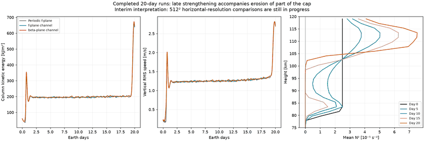
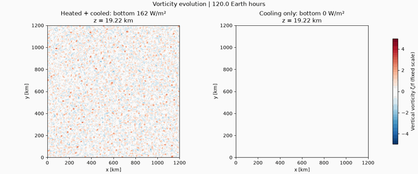
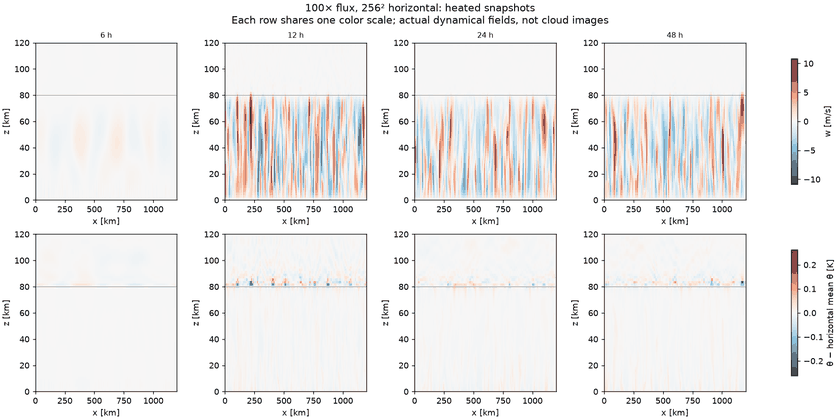
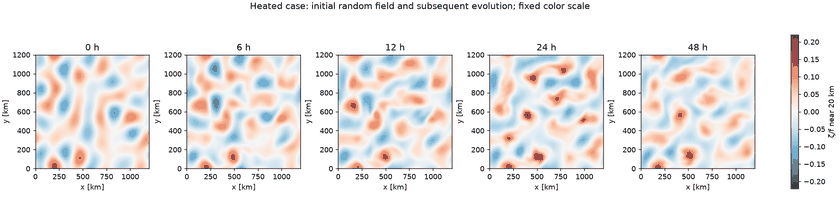
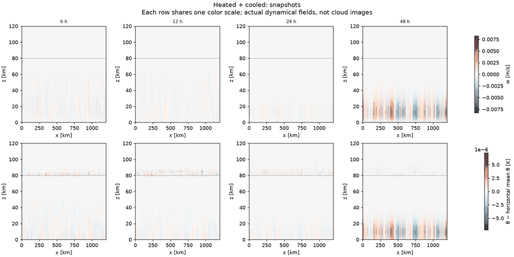
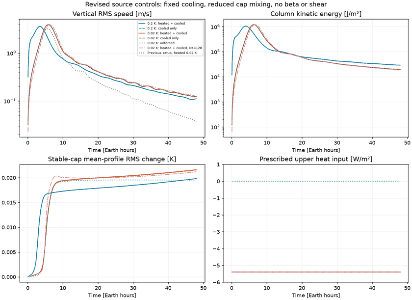
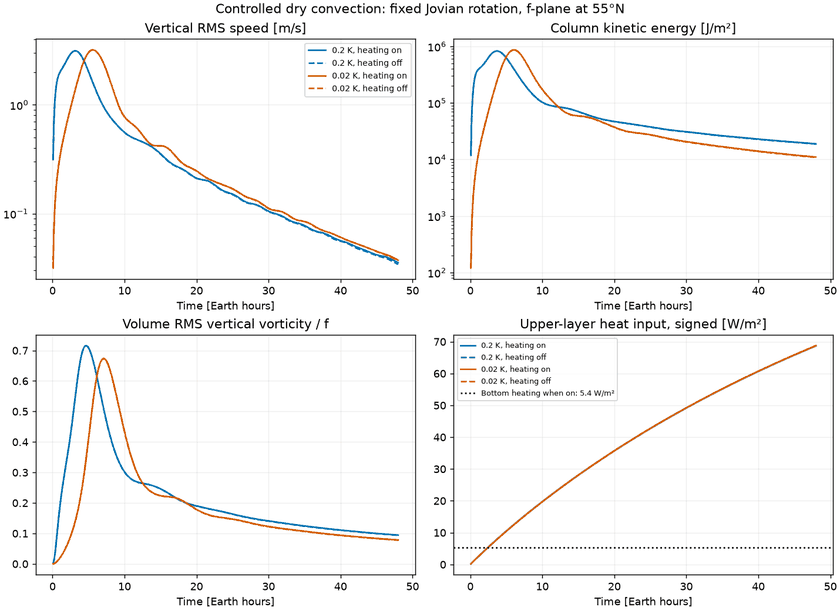
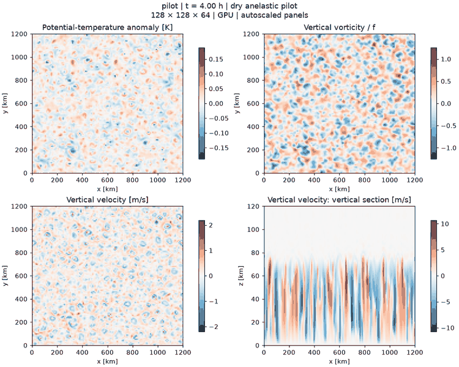

# Output gallery

**[Watch the movies on the gallery landing page](https://npizzo.github.io/jupiter-ffr-breeze/)**

Figures below are generated from saved Breeze fields. They are preliminary numerical tests, not a reproduction of Jupiter's folded filamentary regions.

## November 9: beta and heated-shear segments completed

[Watch the gallery](https://npizzo.github.io/jupiter-ffr-breeze/) · [Run records](progress-2026-11-09/README.md). A matched f/beta movie uses two case rows and three depth columns with common scales. The new heated-shear movie has vorticity above passive concentration. All three runs completed ten-day segments; controls and further segments remain queued.

## New production and heat-budget movies

[Watch the gallery](https://npizzo.github.io/jupiter-ffr-breeze/) · [Run records](progress-2026-11-08/README.md). First ten days of the 6000-km f-plane run, plus forty days of the new heat-budget/tracer validation. The beta segment is in progress; shear production is awaiting resources after passing validation.

## Maintained cap: 40-day validation completed

[Three-depth videos and findings](large40-validation/README.md) · [Campaign design](../docs/large40.md). The 40-day small-box cap test and full-size H100 probe passed; production is queued. All new results include videos near 20, 60 and 100 km. Older entries below predate this requirement and cannot be reconstructed at missing depths.

## Twenty-day runs: interim thermal finding

Three long runs completed. Part of the cap loses stability late in the integration, complicating inverse-cascade interpretation; beta changes final-day bulk energy by about 1%. Horizontal-resolution comparisons are still underway.

[Interim figure and interpretation](regional20-interim/README.md) · [Campaign design](../docs/regional20.md)

## Five-day 30× convection: completed, with videos

Sustained convection, matched controls, and a vertical-resolution comparison.

[Vorticity videos, snapshots and data](convection120/README.md) · [Interpretation](../docs/convection120-results.md)

## Stronger convection: six completed runs

30× and 100× heating produce vigorous convective columns and a large change relative to cooling-only controls. The finer 100× run gives similar bulk vertical speeds but substantially stronger vorticity.

[Snapshots and data](strong48/README.md) · [Interpretation](../docs/strong48-results.md)

## Seeded turbulence: three completed thermal-forcing controls

Identical initial Rossby-0.1 velocity fields isolate the incremental effect of bottom heating. Changes in second-day bulk energy and vertical speed are small over 48 hours.

[Snapshots, spectra and data](turbulence48/README.md) · [Interpretation](../docs/turbulence48-results.md)

## Neutral initial layer: four completed runs

Heating produces weak late growth while the controls decay. Short horizontal wavelengths require further resolution checks before interpreting the patterns.

[Snapshots and data](neutral48/README.md) · [Interpretation](../docs/neutral48-results.md)

## Revised forcing and cap mixing: six completed runs

Fixed upper cooling and reduced thermal diffusion preserve the stable cap. Matched controls show that initial instability still dominates; heating-driven FFRs are not established.

[Latest gallery and data](controlled48/README.md) · [Interpretation](../docs/controlled48-results.md)

## Controlled 48-hour convection experiment

Four runs isolate bottom heating and initial-perturbation amplitude. All completed; the comparisons identify forcing and diffusion limitations in the initial setup.

[Comparison gallery and data](convection48/README.md) · [Interpretation](../docs/convection48-results.md)

## GPU convection pilot

128 × 128 × 64 cells; four simulated hours on one NVIDIA L40S. Convective columns form below the stable cap. This is a transient dry-convection test; folded-filament morphology is not established.

[Animation and run parameters](pilot/README.md) · [Validation and cost](../docs/results.md)

## CPU smoke test

16 × 16 × 24 cells; 60 seconds of simulated time. This checks construction, stepping, and output. The initial random perturbations remain visible at this short duration.

[Animation and run parameters](cpu-smoke/README.md)

The scientific target is sustained Jupiter-like FFR morphology.
