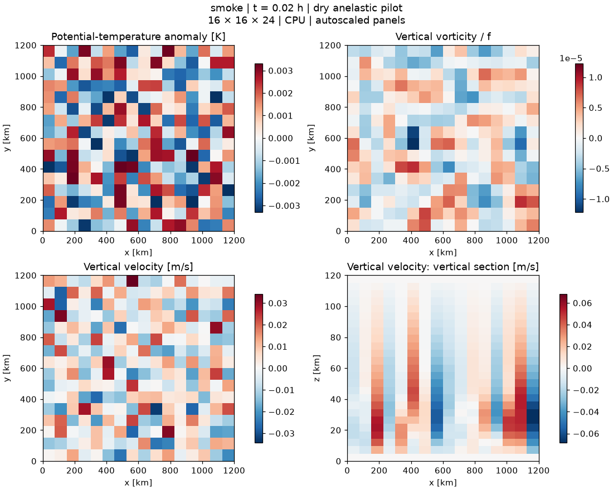

# Output gallery

Figures below are generated from saved Breeze fields. They are preliminary numerical tests, not a reproduction of Jupiter's folded filamentary regions.

## CPU smoke test

16 × 16 × 24 cells; 60 seconds of simulated time. This checks construction, stepping, and output. The initial random perturbations remain visible at this short duration.

[Animation and run parameters](cpu-smoke/README.md)

The larger GPU convection pilot will be added after validation. No RBC performance or morphology comparison is available yet.
