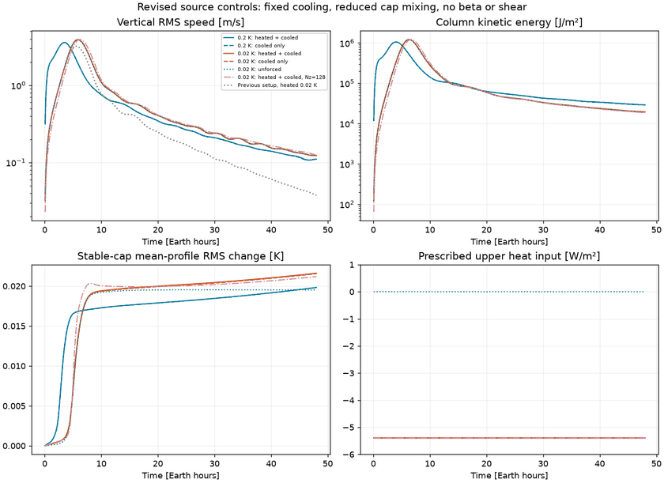
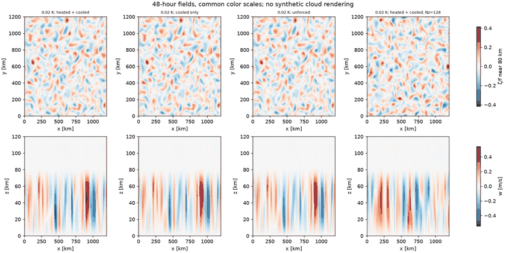
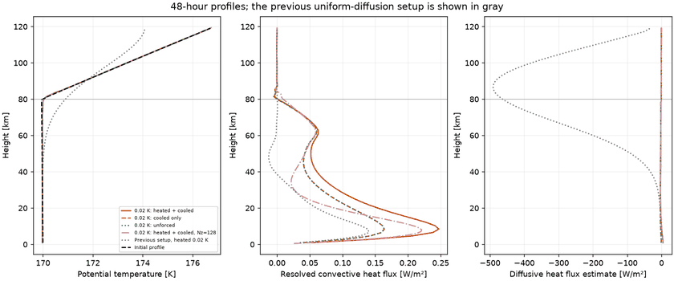
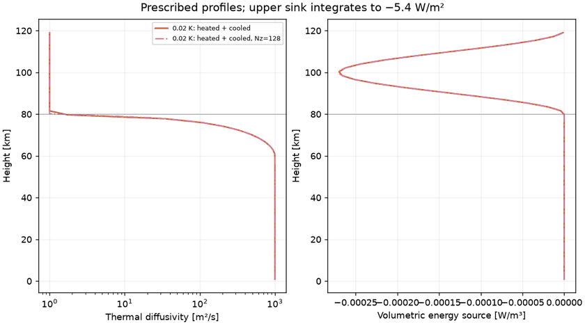
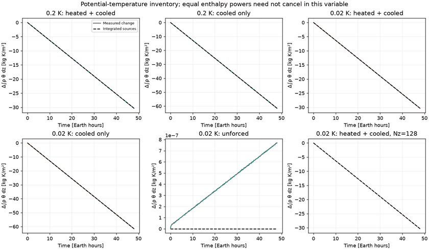

# Fixed cooling and reduced cap mixing: six completed 48-hour cases

The thermal-source and cap-preservation checks pass. Heating changes second-day vertical RMS speed by only 0.1–0.5%; the unforced case behaves almost identically. The initial unstable profile still dominates. Sustained bottom-driven FFR dynamics are not established.

[Results and interpretation](../../docs/controlled48-results.md) · [Design](../../docs/controlled48.md) · [Summary JSON](summary.json) · [Hourly diagnostics](diagnostics_hourly.csv)

## Evolution

Near-overlapping heated, cooled-only, and unforced curves reflect the measured result. Cap change is the RMS difference between the horizontal-mean temperature profile and its initial profile within the cap.



## Final dynamical fields

Top: vertical vorticity divided by f near 80 km. Bottom: vertical-velocity sections. Each row uses common color limits. The different spatial pattern in the refined run also reflects a different initial noise realization; this is not a pointwise convergence test. No synthetic clouds or observational comparison are included.



## Profiles and source checks







The unforced inventory panel has a scale of 10⁻⁷ kg K/m². Its visually apparent drift is numerically tiny compared with the forced-case changes.

## Data and reproduction

Full five-minute diagnostic tables:

- [Heated + cooled, 0.2 K](controlled48_on_p020_diagnostics.csv.gz)
- [Cooled only, 0.2 K](controlled48_off_p020_diagnostics.csv.gz)
- [Heated + cooled, 0.02 K](controlled48_on_p002_diagnostics.csv.gz)
- [Cooled only, 0.02 K](controlled48_off_p002_diagnostics.csv.gz)
- [Unforced](controlled48_unforced_diagnostics.csv.gz)
- [Vertically refined](controlled48_refined_diagnostics.csv.gz)

[Resource record](resources.json). Raw fields remain in the Unity project. To regenerate from solver outputs:

```sh
python scripts/analyze_controlled.py data/controlled48-v2 --previous data/convection48-v1 --output gallery/controlled48
```

The script also writes full-resolution local figures; this repository publishes compact previews.
