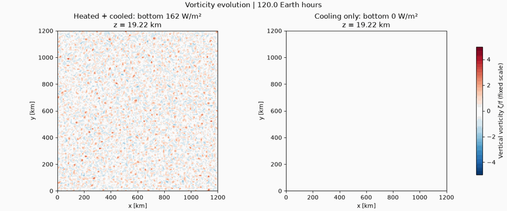
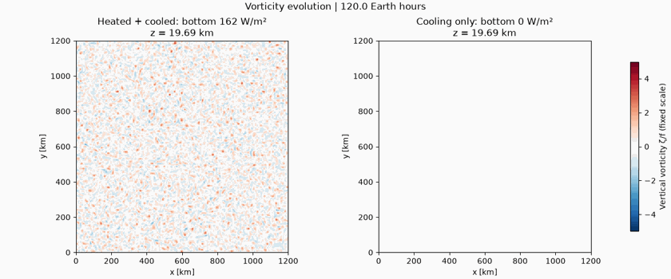
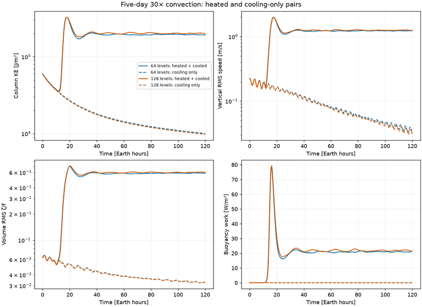
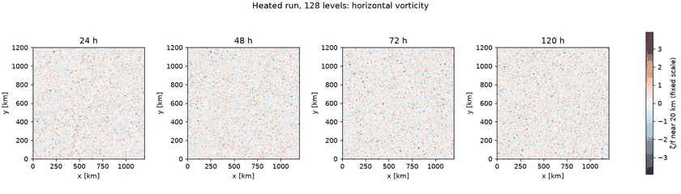
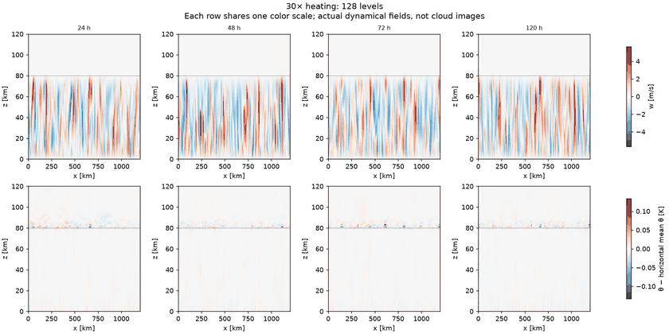
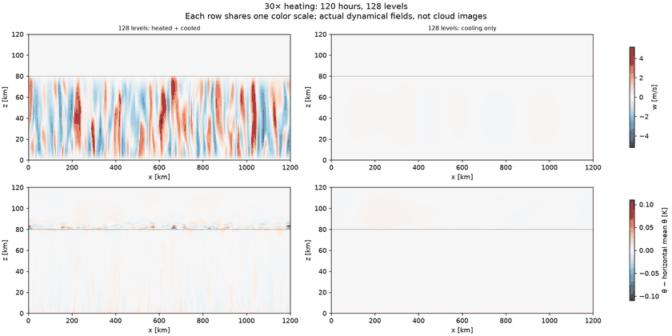
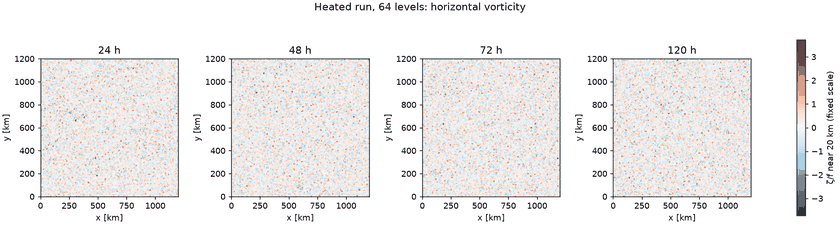
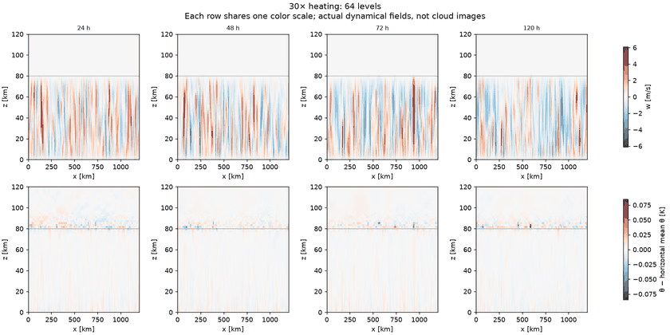
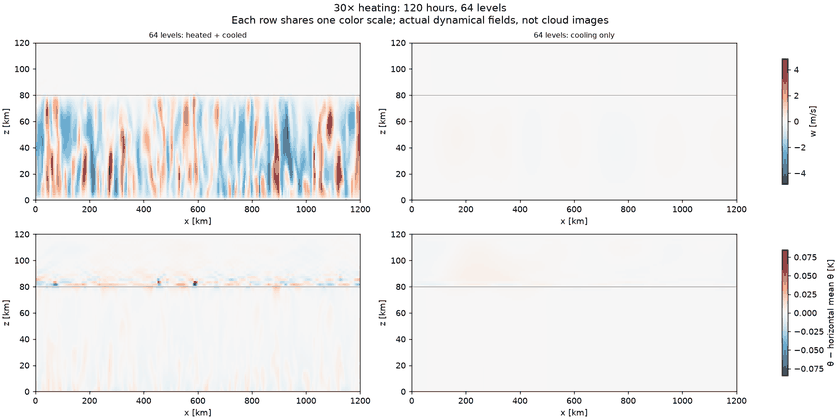
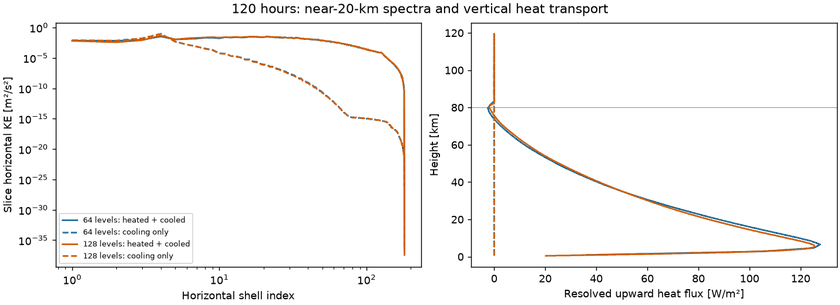

# Five-day 30× convection gallery

All four runs completed. Heating sustains vertical RMS speeds near 1.23–1.25 m/s through day five; controls decay to about 0.04 m/s. Vertical refinement changes bulk measures by 2–4%, but horizontal morphology is not yet converged and FFRs are not established.

[Results and interpretation](../../docs/convection120-results.md) · [Design](../../docs/convection120.md) · [Metrics](summary.json) · [Resources](resources.json)

## Vorticity videos

Each movie contains all **121 hourly frames**, runs about **20 seconds**, and compares heating plus cooling (left) with cooling only (right). Timestamps are simulated Earth hours. One symmetric ζ/f color scale is fixed across time and both cases. Map height is near 20 km. These are compact viewing copies; use saved numerical fields for quantitative morphology analysis.

### 128 vertical levels

[Play or download the 128-level MP4](z128_vorticity.mp4) · [Encoding, timestamps and scale](z128_vorticity.json)

### 64 vertical levels

[Play or download the 64-level MP4](z64_vorticity.mp4) · [Encoding, timestamps and scale](z64_vorticity.json)

## Bulk evolution

## Snapshots: 128 levels

## Snapshots: 64 levels

## Spectra and transport

Spectra use one horizontal slice and do not measure spectral energy transfer. The heat-flux profile is a resolved diagnostic, not the exact discrete boundary flux.

## Diagnostic histories

- [convection120_f030_heated_h256_z64](convection120_f030_heated_h256_z64_diagnostics.csv.gz)
- [convection120_f030_cooled_h256_z64](convection120_f030_cooled_h256_z64_diagnostics.csv.gz)
- [convection120_f030_heated_h256_z128](convection120_f030_heated_h256_z128_diagnostics.csv.gz)
- [convection120_f030_cooled_h256_z128](convection120_f030_cooled_h256_z128_diagnostics.csv.gz)
