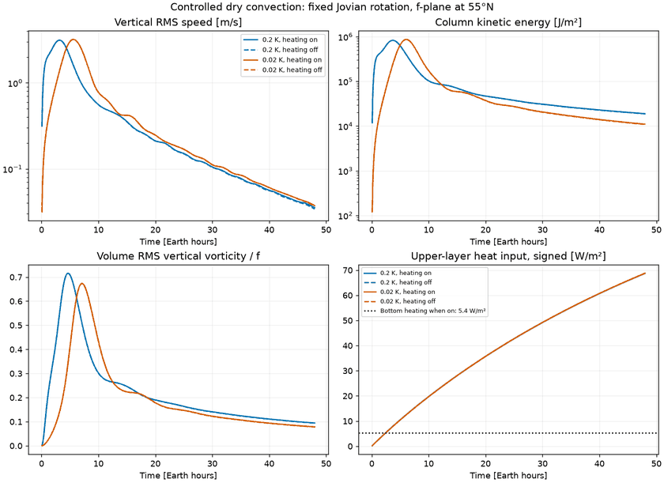
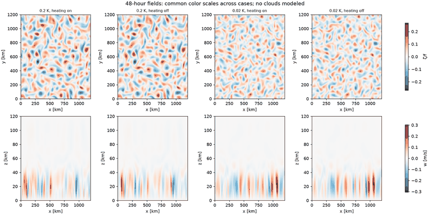
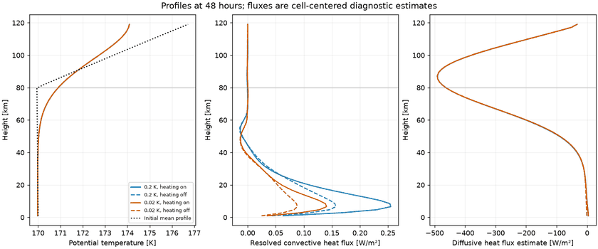
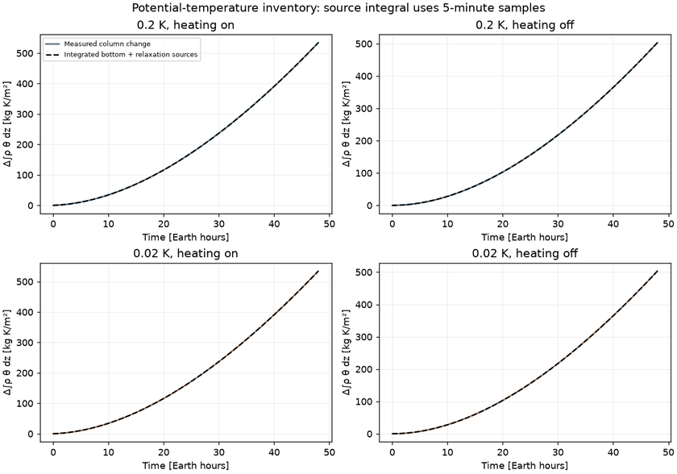

# Controlled convection: four 48-hour runs

**All runs completed.** Heating-on and heating-off cases both show an initial convective burst followed by decay. The current upper relaxation supplies heat, and constant diffusion substantially alters the stable cap. Sustained bottom-driven FFR dynamics are not established.

[Interpretation and numerical results](../../docs/convection48-results.md) · [Design and parameters](../../docs/convection48.md)

## Evolution

Solid lines: bottom heating on. Dashed lines: heating off. Colors distinguish the two initial perturbation parameters. Near-overlap within each pair is a result, not a missing curve.

## Final fields

Common color scales across cases. Top: horizontal vertical-vorticity/f slice near the original cap base. Bottom: vertical-velocity section. These are dynamical fields, not synthetic cloud images.

## Profiles and thermal inventory

## Data and reproduction

[Summary JSON](summary.json) · [Hourly diagnostics CSV](diagnostics_hourly.csv) · [Full five-minute diagnostics, compressed CSV](diagnostics_5min.csv.gz) · [Resource measurements](resources.json)

Run `python scripts/analyze_convection.py data/convection48-v1 --output gallery/convection48` to regenerate the analysis from the saved solver output. Compact previews are published here; the script also writes full-resolution figures locally. Raw fields remain in the Unity project. The numerical summary uses the five-minute diagnostics; the hourly CSV is a convenience subset.
