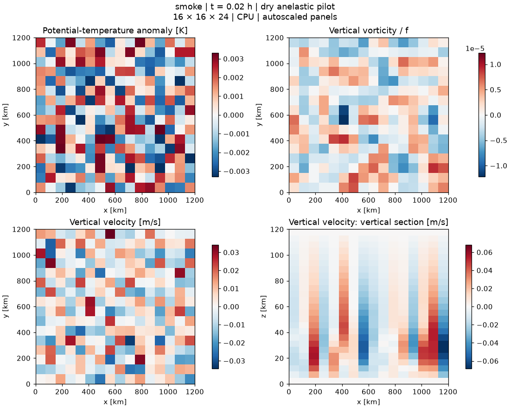
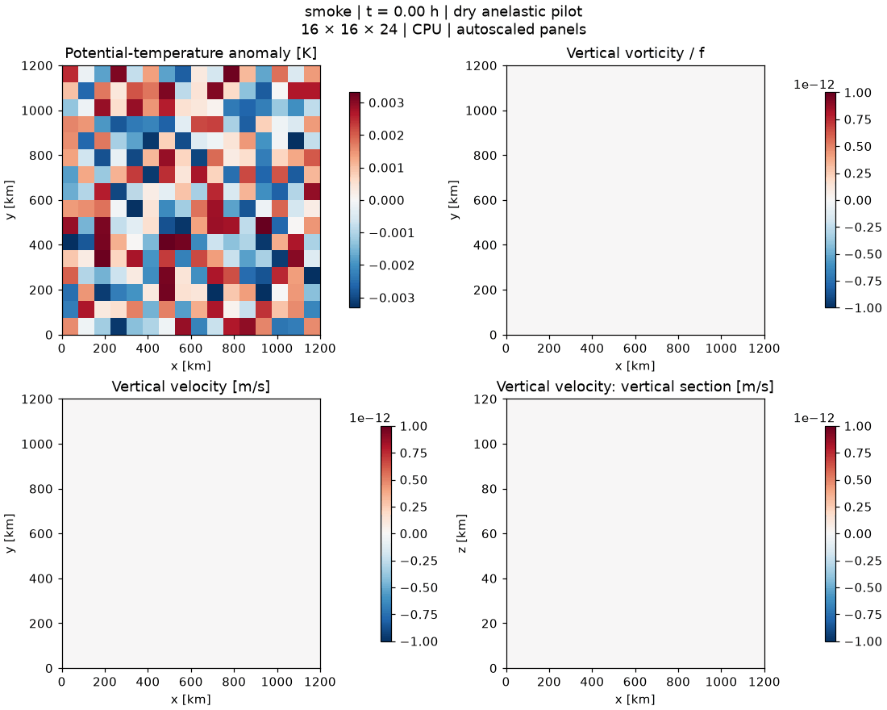

# smoke

Actual solver output. Status: **COMPLETE**. This is an engineering / convection test, not a demonstrated FFR.

Panels autoscale independently in each frame; compare amplitudes using the color bars. [Run parameters](metadata.json).
