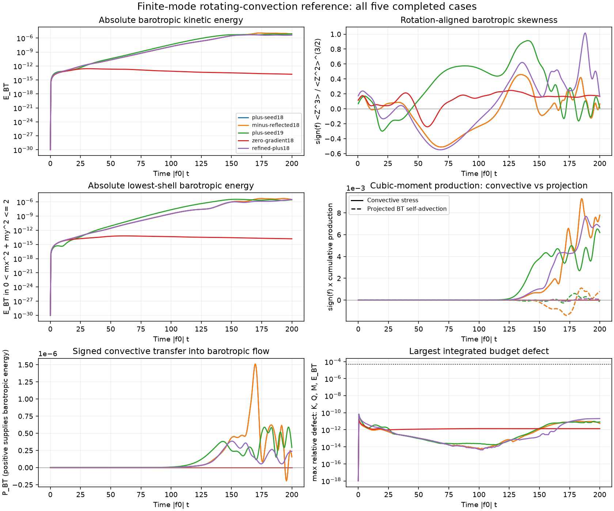

# Nonlinear Galerkin convection: completed reference experiment

All 5 declared cases completed through |f0|t=200. These are finite-mode, fixed-temperature rotating Boussinesq experiments, not the capped Breeze atmosphere.

The movies show actual reconstructed vertical vorticity above buoyancy perturbation at three saved heights. There is no passive tracer. Each field has one common symmetric asinh scale across all cases, times and depths.

Over the final quarter, rotation-aligned barotropic skewness averaged 0.08286 for seed A and 0.146 for seed B. Positive aligned skewness means a cyclonic statistical bias; it does not establish a single persistent vortex.

The nested extension's final-quarter aligned skewness was 0.4421; its mean power into the barotropic flow was 2.037e-07. This comparison is a truncation-sensitivity check, not a converged DNS result.

The largest recorded integrated relative budget defect was 7.06e-11 across kinetic energy, thermal variance, potential moment and barotropic kinetic energy. The cubic-moment plot separates convective production from projected barotropic self-advection; the latter need not vanish in a finite Galerkin model.

The completed reflected pair's saved-field relative L2 mismatch was 1.46e-14 for vorticity and 8.01e-15 for buoyancy. Reflection reverses both f and vorticity, while preserving scalar buoyancy.

The zero-imposed-gradient control retains the same initial buoyancy perturbation and its force. It has a finite thermal reservoir and is not pure velocity-only decay.

The narrow box contains only a few critical convective wavelengths. Two seeds and one extension cannot establish a robust Jovian sign-selection mechanism or a broad inverse cascade. Absolute low-shell energy and signed stress power are provided so morphology and energy fractions are not mistaken for transfer evidence.

| Case | Final E_BT | Final low-shell E_BT | Final-quarter aligned skewness | Mean P_BT |
|---|---:|---:|---:|---:|
| Convective seed A, f = +1 | 8.01e-06 | 3.165e-06 | 0.08286 | 5.142e-07 |
| Reflected seed A, f = -1 | 8.01e-06 | 3.165e-06 | 0.08286 | 5.142e-07 |
| Convective seed B, f = +1 | 7.507e-06 | 2.774e-06 | 0.146 | 3.427e-07 |
| Zero imposed gradient, seed A | 1.695e-14 | 1.572e-14 | 0.1657 | 7.925e-18 |
| Nested extension, seed A, f = +1 | 4.326e-06 | 3.175e-06 | 0.4421 | 2.037e-07 |

## Movies

- [Convective seed A, f = +1](plus-seed18.mp4)
- [Reflected seed A, f = -1](minus-reflected18.mp4)
- [Convective seed B, f = +1](plus-seed19.mp4)
- [Zero imposed gradient, seed A](zero-gradient18.mp4)
- [Nested extension, seed A, f = +1](refined-plus18.mp4)

Fixed color scales and movie verification are recorded in `publication-metrics.json`. Cumulative third-moment production uses saved-sample trapezoidal quadrature, not an RK-stage budget test.
