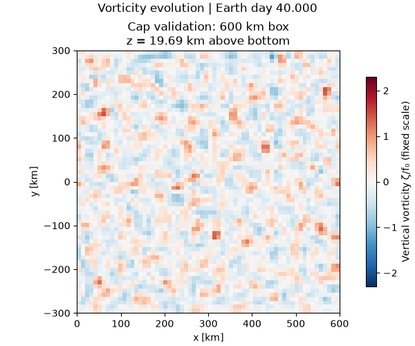
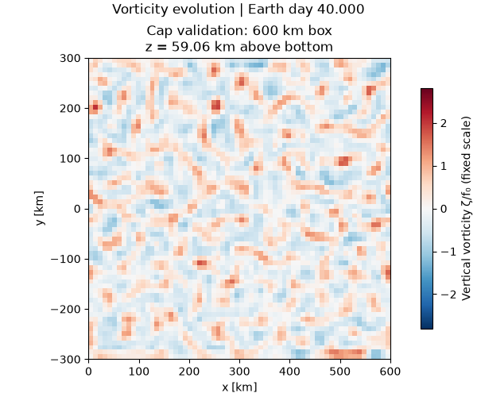
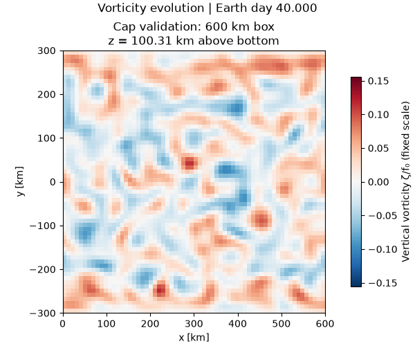

# Stable-cap validation: 40 Earth days

**[Watch the movies on the gallery landing page](https://npizzo.github.io/jupiter-ffr-breeze/)**

This is the **600 × 600 km, 64 × 64 × 64 thermal-validation box**, not the new 6,000-km production domain. It uses the same bottom heating, cap relaxation and vertical grid as production. All 321 saved times are shown, with no temporal interpolation.

The protected 90–115 km cap core retains at least **99.90% of its initial mean-profile N²** throughout 40 Earth days. The source-budget and restart tests passed. Final-day domain-wide vertical RMS is **1.23 m/s**, so the cap remains stable in the presence of sustained convection.

The maintained profile is an idealized thermal reservoir, not a balanced radiative sink: during the final day it **adds 4.85 W/m²** on average, alongside the 162 W/m² bottom input. Net external heating is therefore **166.85 W/m²**. This is still a thermally evolving experiment, not thermal equilibrium. The large-domain cap guard remains active.

## Vorticity at three depths

Heights are above the model bottom. Each movie has its own fixed symmetric color scale across the entire 40 days; colors should not be compared quantitatively between depths without reading the scale. These are dry-model velocity diagnostics, not cloud images or evidence that Jupiter FFRs have been reproduced.

**Lower convection — 19.69 km**

**Upper convection — 59.06 km**

**Stable cap — 100.31 km**

[Movie provenance and color scales](videos.json) · [Numerical summary](summary.json) · [Campaign design](../../docs/large40.md)

## Full-size probe and production queue

The **1,024 × 1,024 × 64, 6,000-km** probe completed successfully on an **80-GB H100**, including checkpoints, three-depth output, source budgets and wall-boundary checks. Its post-startup throughput projects **2.34 wall-clock hours per 10 simulated days**. This is an early benchmark; mature turbulence can change the cost. The scheduler recorded about **14.46 GiB peak host RAM** for that job; this is not GPU memory usage.

The eight production segments remain submitted. As of November 8, 2026, approximately 21:44 UTC, the first segment is waiting on scheduling priority. Based on the measured cost, all eight pending jobs were reduced from five-day to **12-hour wall-time limits**, retaining about fivefold margin while allowing shorter scheduling windows. The numerical setup and requested physical duration are unchanged. Subsequent segments depend on successful completion of their predecessors.

Repository videos are compact H.264 copies retaining every frame. Higher-quality renders and the raw fields are retained separately.
