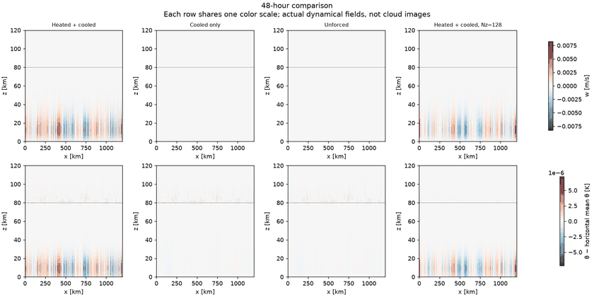
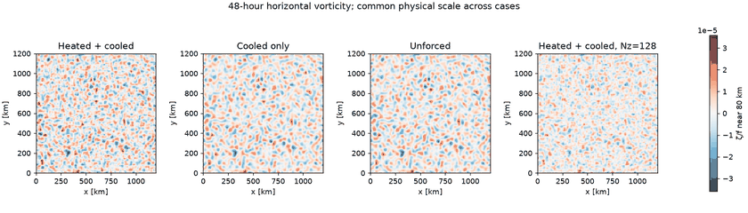
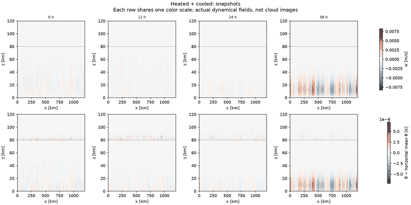
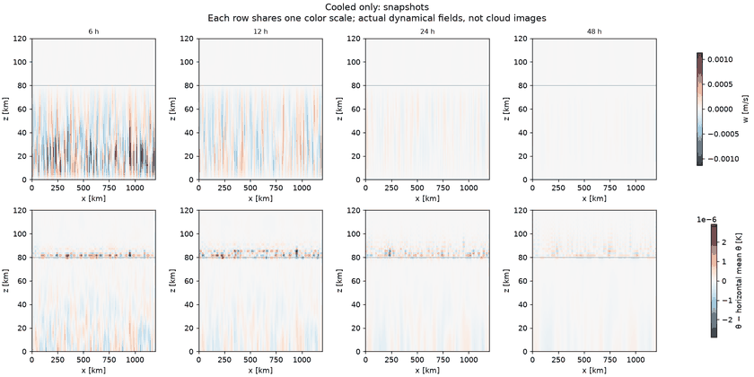
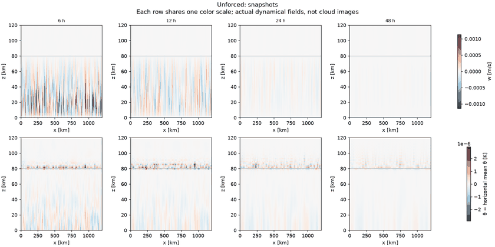
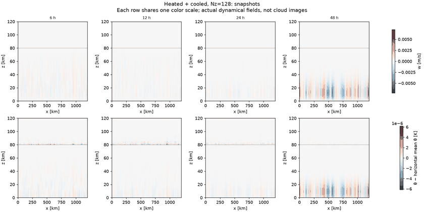
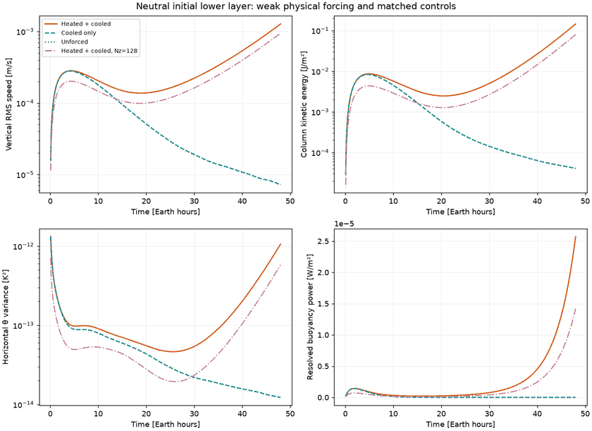
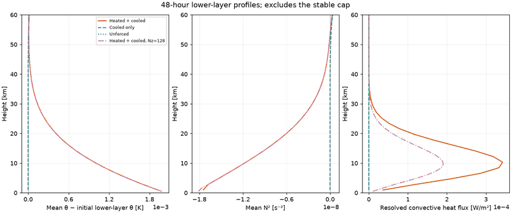

# Neutral-layer test: snapshots and controls

**Completed:** Weak late growth appears in heated cases while controls decay. Short horizontal wavelengths raise a resolution concern; developed convection and FFR morphology are not established.

The mean lower layer starts neutral, with a tiny seeded perturbation. Heated/cooled, cooled-only, and unforced cases share identical initial conditions at the standard resolution. A fourth heated/cooled run doubles vertical resolution. See [design](../../docs/neutral48.md), [results](../../docs/neutral48-results.md), and [numerical summary](summary.json).

## Final comparison at 48 hours

Top: vertical velocity interpolated to cell centers. Bottom: temperature departure from the horizontal mean at each height. Each row uses one shared color scale across all cases. The refined grid has a different spatial realization of initial noise, so pointwise agreement is not expected.





The vorticity view is near 80 km; it is not a map of the strongest motion near the bottom. These are dry dynamical fields, not cloud images. Color bars show actual units; visual contrast alone is not evidence of strong convection.

## Snapshots through each run

Each sequence shows 6, 12, 24, and 48 Earth hours. Color scales are fixed across time within each row of a sequence. Separate sequences use different ranges; use the final-comparison figure above to compare cases on the same scale.

### Heated and cooled



### Cooling only



### Unforced



### Heated and cooled, doubled vertical resolution



## Evolution and lower-layer profiles





The profiles show 0–60 km to isolate the initially neutral layer. The stable cap begins at 80 km.

## Data and reproduction

[Resource record](resources.json). Full five-minute diagnostic tables:

- [Heated + cooled](neutral48_heated_diagnostics.csv.gz)
- [Cooling only](neutral48_cooled_diagnostics.csv.gz)
- [Unforced](neutral48_unforced_diagnostics.csv.gz)
- [Vertically refined heated case](neutral48_refined_diagnostics.csv.gz)

Raw snapshots remain in the Unity project. Regenerate the figures using:

```sh
python scripts/analyze_neutral.py data/neutral48-v1 --output gallery/neutral48
```

Compact previews are published here. The analysis also produces full-resolution local figures. The section spectrum in the summary uses only one x-z slice below 40 km; it is a resolution warning, not a full 3D spectral analysis or convergence test.
