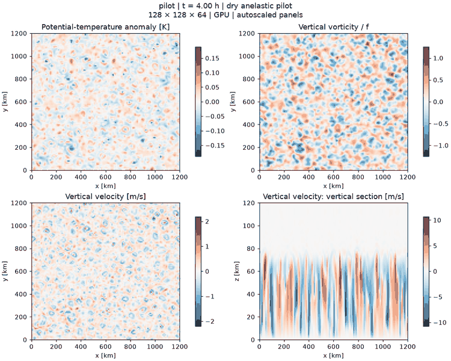
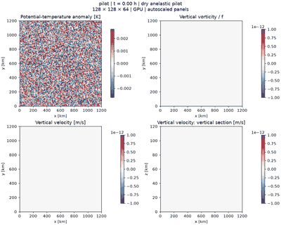

# pilot

Actual solver output. Status: **COMPLETE**. This is an engineering / convection test, not a demonstrated FFR.

Panels autoscale independently in each frame; compare amplitudes using the color bars. [Run parameters](metadata.json).

The animation is a compact preview at 40-minute simulated-time intervals. Gallery assets are compact previews. The plotting script also saves full-resolution individual frames, which are excluded from Git. [Validation and performance context](../../docs/results.md).
