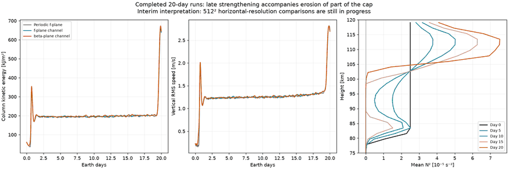

# Interim 20-day comparison: thermal evolution limits interpretation

The periodic f-plane, f-plane channel and physical beta-plane channel each completed 20 Earth days and passed the configured numerical checks. The two 512² horizontal-resolution runs are not yet both complete. These are interim results, not a completed campaign or convergence claim.

**The main new finding is erosion of part of the stable cap.** At day 10, cap mean N² is still positive. By day 15 it is slightly negative near 91–97 km. By day 20, much of the 80–100 km interval has become almost neutral, with small negative values at several levels. The uppermost cap remains strongly stable. This happens in all three geometries/rotation cases and accompanies the sharp energy increase near the end of the run. Prescribed upper cooling is a plausible driver of this evolving stratification; these comparisons do not by themselves isolate its causal contribution from heat transport.

The late energy increase cannot be assigned to an inverse cascade alone. The underlying convective layer and energy supply are changing. A broad top-to-bottom cap contrast was insufficient to diagnose this: subsequent interpretation must use the full N² profile. The next forcing-design work should address long-term cap evolution before simply extending the same setup further. No forcing changes or additional jobs were submitted with this interim report.

## Beta comparison

Over hours 456–480, channel kinetic energy is 368478 J/m² with beta and 364858 J/m² without beta: **+0.99%**. Vertical RMS speeds are 2.0128 and 2.0136 m/s: **-0.043%**. These are averages over the final day, which includes the sharp late acceleration; they are not equilibrium values. Similar bulk values do not exclude differences in spatial organization or spectral transfer.

A previous 24-frame window at hours 230–253 of the periodic reference showed negative projected-barotropic self-flux at several intermediate wavenumbers, consistently across that window. That remains preliminary evidence of upscale transfer within that mode, not a full three-dimensional, long-time or resolution-verified inverse cascade. It predates the strongest late acceleration and must be assessed separately from it.

[Compact numerical record](summary.json) · [Experiment and diagnostic definitions](../../docs/regional20.md)

Full-campaign paired videos and resolution comparisons remain pending; the completed five-day videos are in the [earlier gallery](../convection120/README.md).
