# Stronger-heating snapshots

All six runs completed. Bottom heating now drives vigorous convection and strongly changes the seeded rotating flow. Fine-scale vorticity remains resolution-sensitive; folded filamentary regions are not established.

[Results and interpretation](../../docs/strong48-results.md) · [Experiment](../../docs/strong48.md) · [Metrics](summary.json) · [Resources](resources.json)

## Evolution and control comparisons

Solid curves include bottom heating and upper cooling; dashed curves have identical upper cooling and initial turbulence, with no bottom heating.

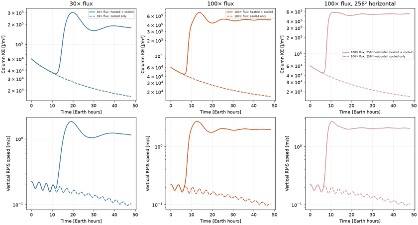

## 100× heating, finer horizontal grid

Vertical sections show vertical velocity and potential-temperature anomaly at 6, 12, 24 and 48 hours. Each row uses one color scale. The line marks the original 80-km cap base.

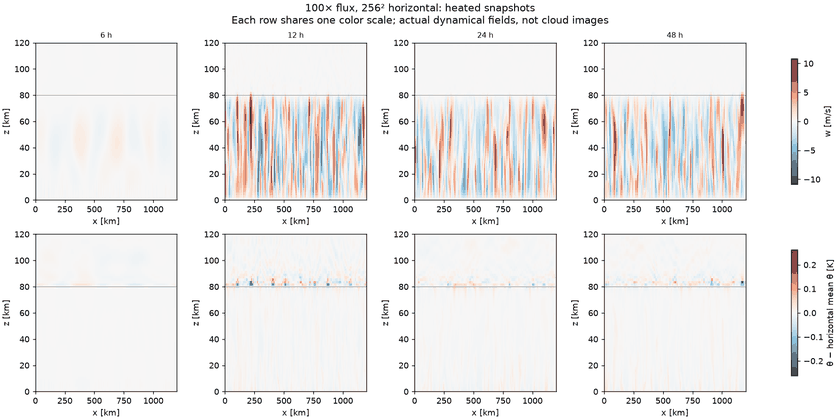

The following maps are vertical vorticity divided by f near 20 km. Heated and control maps share the same scale; a faint control means its amplitude is much smaller, not zero.

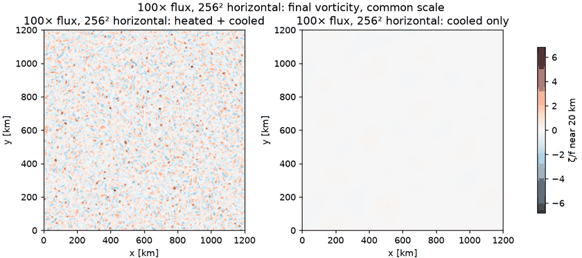

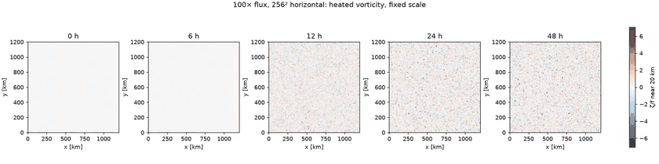

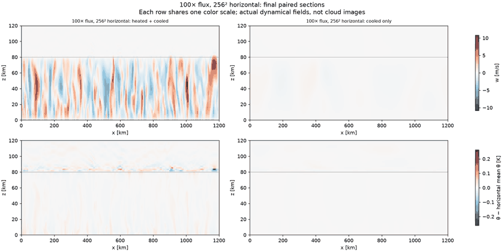

## 30× heating

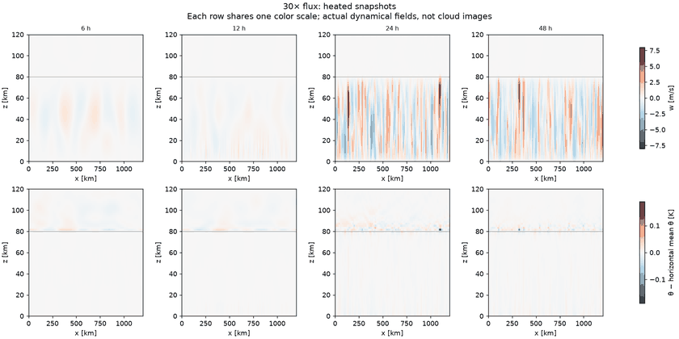

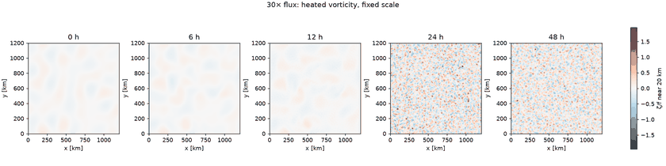

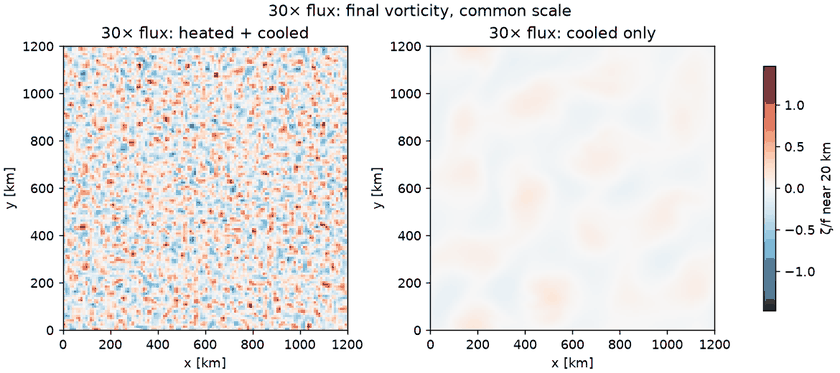

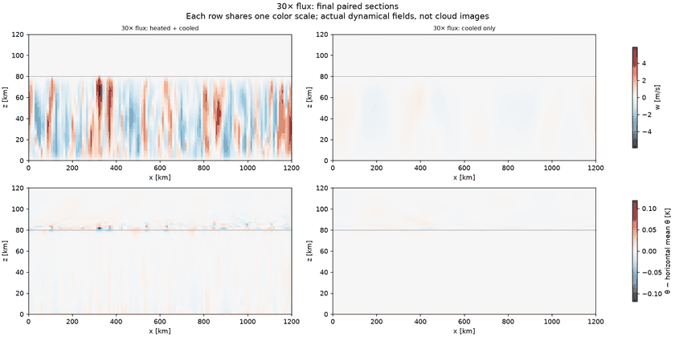

## 100× heating, original horizontal grid

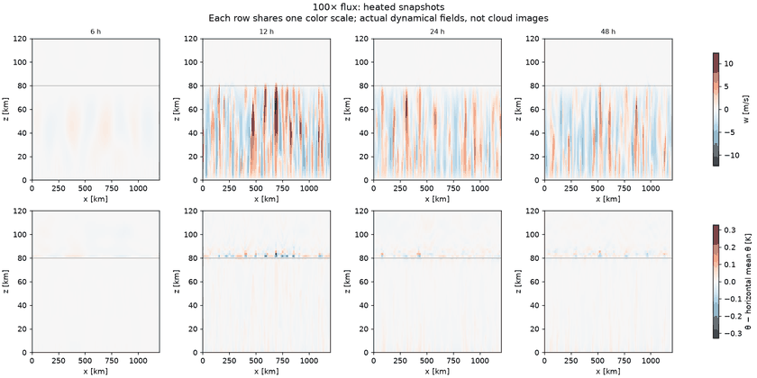

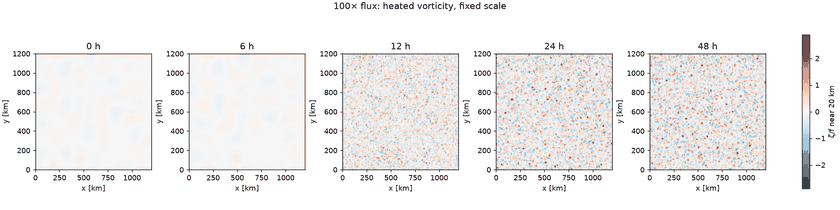

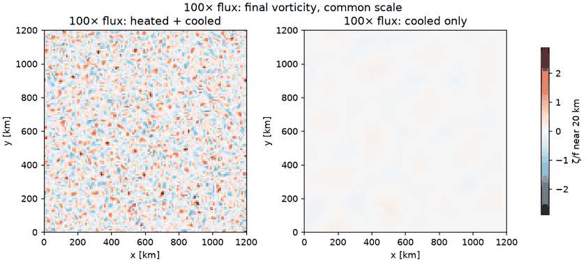

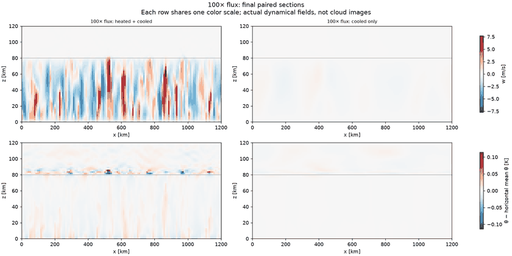

## Spectra and data

These are horizontal velocity spectra from one level near 20 km, not full-depth transfer budgets. The same horizontal shell index represents the same physical wavelength across these fixed-size domains.

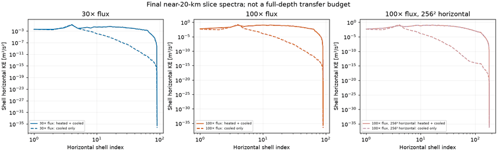

Full five-minute diagnostic histories:

- [strong48_f030_heated](strong48_f030_heated_diagnostics.csv.gz)
- [strong48_f030_cooled](strong48_f030_cooled_diagnostics.csv.gz)
- [strong48_f100_heated](strong48_f100_heated_diagnostics.csv.gz)
- [strong48_f100_cooled](strong48_f100_cooled_diagnostics.csv.gz)
- [strong48_f100_heated_h256](strong48_f100_heated_h256_diagnostics.csv.gz)
- [strong48_f100_cooled_h256](strong48_f100_cooled_h256_diagnostics.csv.gz)
