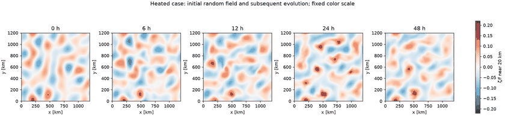
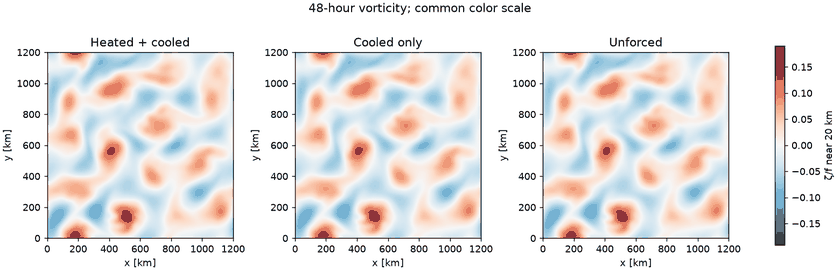
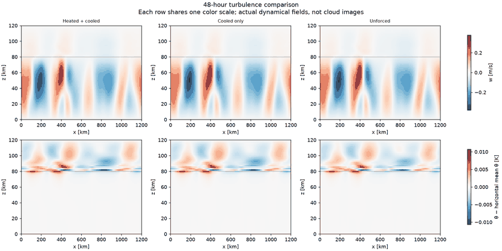
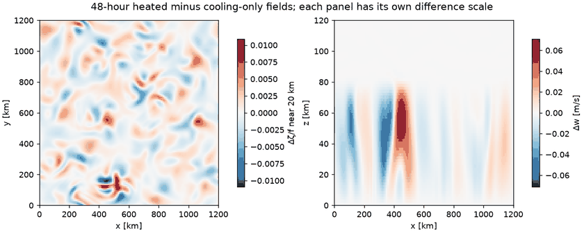
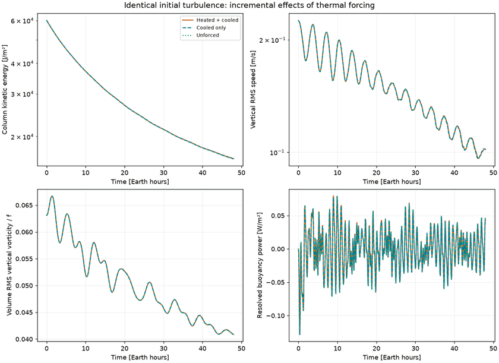
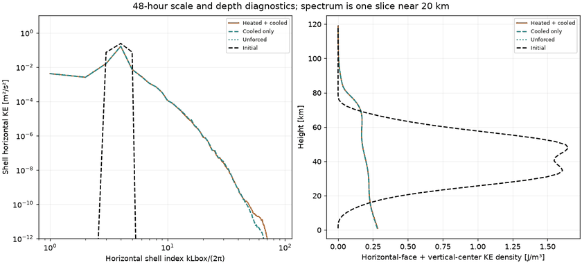
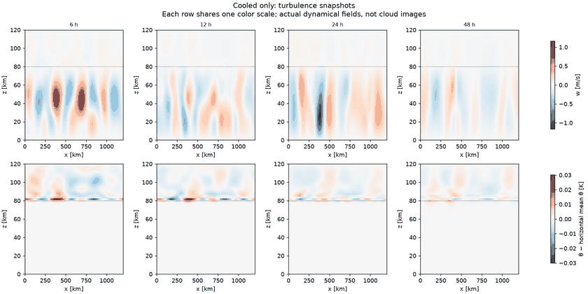

# Convection acting on seeded turbulence

**Completed:** Bottom heating changes second-day kinetic energy by +0.117% and vertical RMS speed by +0.086% relative to the cooling-only control. The seeded flow still dominates this 48-hour window.

Three cases share an identical initial three-dimensional velocity field with eddy Rossby number 0.1. Thermal sources distinguish heated/cooled, cooled-only and unforced runs. See [design](../../docs/turbulence48.md), [results](../../docs/turbulence48-results.md), [summary](summary.json), and [resource record](resources.json).

## Evolution of the heated case

Horizontal vorticity near 20 km, from the initial random field through 48 hours. All times share one color scale.



## Final comparisons

Common scales across cases; these are dynamical fields, not cloud renderings.





The difference panels below use their own smaller scales. Visible contrast in a difference image alone does not mean a large effect on total turbulent energy, and a spatial difference between chaotic trajectories is not a statistically established change in turbulence.



## Energy, transport and spatial scales





Spectra use one horizontal slice and obey a checked Parseval energy identity. They are not full-depth spectra or spectral energy-transfer measurements. Increased low-wavenumber content alone does not establish an inverse cascade. The initial condition is a prescribed random field, not equilibrated turbulence; early evolution includes adjustment.

## Vertical-section snapshots

Snapshots show 6, 12, 24 and 48 Earth hours. Velocity is interpolated to cell centers. Temperature anomalies are relative to the horizontal mean at each height. Scales are fixed within each sequence, but differ between sequences; use the common-scale final comparison above to compare amplitudes.





## Data

- [Heated/cooled five-minute diagnostics](turbulence48_heated_diagnostics.csv.gz)
- [Cooling-only five-minute diagnostics](turbulence48_cooled_diagnostics.csv.gz)
- [Unforced five-minute diagnostics](turbulence48_unforced_diagnostics.csv.gz)

Raw fields remain on Unity. Regenerate these figures using:

```sh
python scripts/analyze_turbulence.py data/turbulence48-v1 --output gallery/turbulence48
```

The script saves full-resolution local figures as well as the compact published previews. This comparison retains the same anelastic box, Jovian f, beta = 0 and zero imposed shear.
